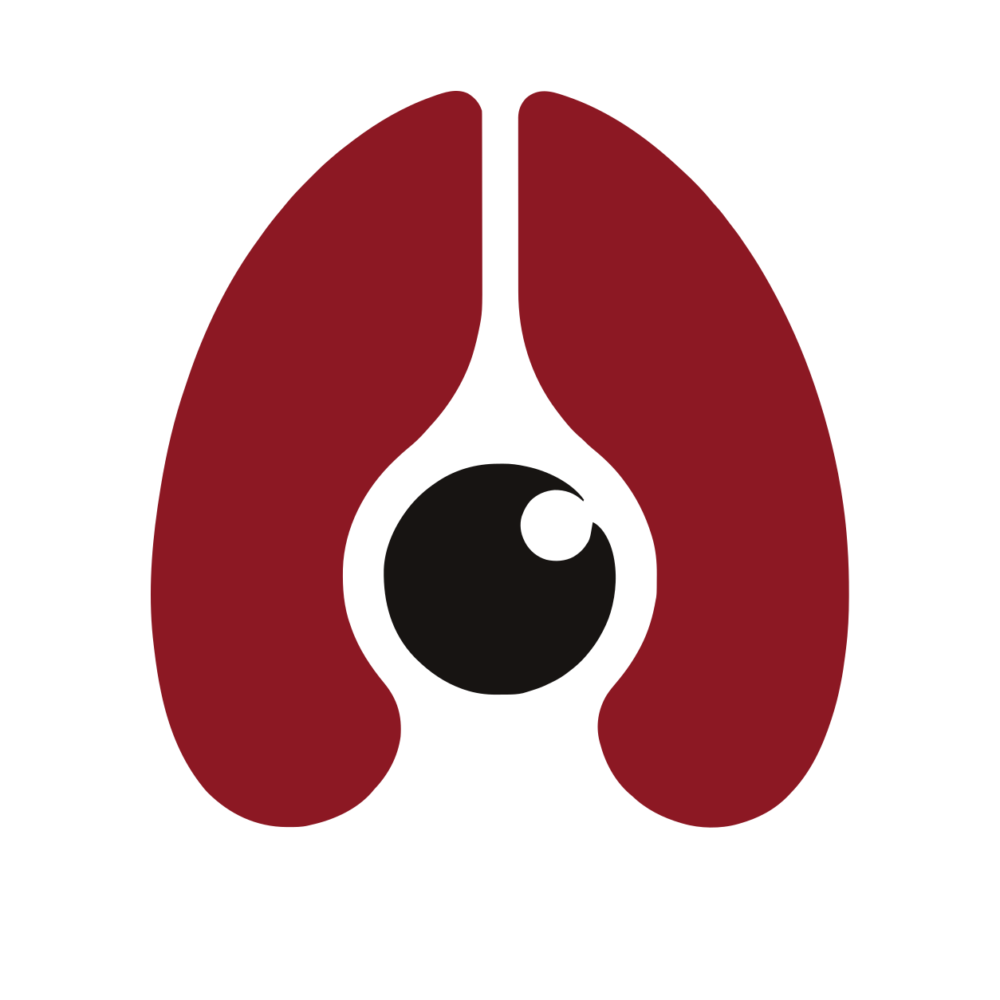

# AgarthaVision

<p align="center">
  
</p>

<p align="center">
  <strong>Clinical microscopy assistant for AI-supported Soil-Transmitted Helminth surveillance.</strong>
</p>

<p align="center">
  
  
  
  
  
  
  
</p>

## Overview

AgarthaVision is a mobile diagnostic-support and surveillance platform for fecal smear microscopy workflows. It helps medical technologists capture microscope frames, run AI-assisted parasite egg detection, verify results through a human-in-the-loop workflow, compute per-species Low Power Field (LPF) density ranges, and archive structured records for reporting and provincial coverage tracking.

The project is a decision-support and preprocessing tool. It does not replace qualified medical judgment, final diagnosis, or laboratory validation.

## Features

- **Patient-based records** — sessions and samples are organized under a patient, with PSGC barangay residence for surveillance aggregation.
- **AI-assisted capture** — CameraX capture that saves the frame at once and queues it for inference in the background: the self-hosted FastAPI container first, the bundled on-device model whenever the cloud cannot answer.
- **Human-in-the-loop verification** — every model detection is confirmed, corrected, or rejected by a medtech before it counts, with pre-filled answers, per-box species/stage questions, and an always-available manual "Add Egg" path.
- **LPF density reporting** — per-species Low Power Field density ranges (Direct Smear method) with a qualitative descriptor, replacing EPG/Kato-Katz.
- **PDF session reports** — generated on-device from local Room data and synced to Supabase.
- **My coverage dashboard** — an offline, province-level choropleth map of examined smears built from a bundled PSGC boundary dataset, no network call required.
- **Soft-delete safe** — a duplicate or rejected sample can be hidden from view without deleting its detections from the retraining corpus.

Phase 2 work — owned capture/inference hardware and a fuller self-hosted backend stack — is documented but intentionally deferred; see [`docs/features.md`](docs/features.md).

## Deployment

| Part | Where | Platform |
| --- | --- | --- |
| Mobile app (Android 8.0 or newer) | [Release v0.1.0-mvp](https://github.com/Joryuoo/AgarthaVision/releases/tag/v0.1.0-mvp): download `AgarthaVision-v0.1.0-mvp.apk` under Assets | GitHub Releases (signed APK) |
| Admin console (web) | <https://agarthan-admin.vercel.app> ([repository](https://github.com/kazuretsu/AgarthaVision-Admin)) | Vercel |
| Backend | Not opened directly: the app and the console sign in and store data through it | Supabase (Auth, Postgres, Storage) |

To install the app, open the release on an Android phone, download the APK, and allow installs from that source when Android asks. APK files are attached to the release, never committed to this repository.

## Tech Stack

| Area | Technology |
| --- | --- |
| Language | Kotlin 2.2.10 |
| Platform | Android, min SDK 26, target SDK 36 |
| UI | Jetpack Compose, Material 3, Agartha components |
| Architecture | MVVM, Clean Architecture, Hilt |
| Local data | Room |
| Camera | CameraX |
| Networking | Retrofit, OkHttp, Ktor client |
| Cloud data | Supabase Auth, PostgREST, Storage |
| Inference | FastAPI container with custom Ultralytics model weights |
| Tooling | Gradle Kotlin DSL, Bun scripts, ktlint, detekt, commitlint |

See [`docs/stack.md`](docs/stack.md) for exact library versions read from `gradle/libs.versions.toml`.

## Architecture

AgarthaVision uses MVVM with Clean Architecture boundaries inside a single Android application module.

```text
app/
  src/main/java/com/agarthavision/
    core/       Shared platform services, DI, database, networking, utilities
    domain/     Pure Kotlin models, repositories, and use cases
    data/       Room, Supabase, Retrofit, mappers, and repository implementations
    ui/         Jetpack Compose screens, ViewModels, navigation, and theme

supabase/
  migrations/
    0001_init.sql   Consolidated Postgres schema and RLS for the current project
    legacy-dev/     Archived pre-patient migration history (superseded)

inference/
  Dockerfile   Self-hosted FastAPI inference container
  server.py    GET /health and POST /infer
  weights/     Model weights used by the inference image

tools/
  geo/    Offline province/town boundary asset pipeline (PSGC-keyed)
  psgc/   Offline barangay reference database build
```

Key rules — the full set of thirteen architectural/clinical/process constraints (with enforcement points) lives in [`docs/constraints.md`](docs/constraints.md). Short version:

- ViewModels call domain use cases, not data-layer classes directly.
- Domain models remain pure Kotlin and do not import Android APIs.
- Room entities and remote DTOs are mapped into domain models.
- Supabase is the Auth, Postgres, and Storage provider.
- The inference service is stateless: it receives a frame, returns predictions, and does not persist images.
- No model output counts as a finding until a human confirms it.

## Getting Started

### Prerequisites

- JDK 21
- Android Studio or IntelliJ IDEA with Android SDK 36
- Bun
- Git
- Access to the team Supabase and inference credentials

### Setup

1. Clone the repository.

   ```bash
   git clone https://github.com/Joryuoo/AgarthaVision.git
   cd AgarthaVision
   ```

2. Install project tooling and Git hooks.

   ```bash
   bun install
   ```

3. Create your local secrets file.

   ```bash
   cp local.properties.example local.properties
   ```

4. Fill `local.properties` with the Supabase, Turnstile and inference values shared by the team. The Supabase key is the publishable one (`sb_publishable_…`, Project Settings → API Keys), never the legacy `anon` JWT. Never commit real keys. See [Environment variables](#environment-variables) for the full list.

5. Open the project in Android Studio and let Gradle sync, or verify from the command line:

   ```bash
   ./gradlew assembleDebug
   ```

On Windows PowerShell, use `.\gradlew.bat assembleDebug` if the shell does not resolve `./gradlew`.

### Environment variables

The app reads these from `local.properties` (gitignored) into `BuildConfig` at build time (`app/build.gradle.kts`). A debug build uses the `_DEV` values and a release build uses the `_PROD` values. [`local.properties.example`](local.properties.example) is the committed template, with placeholders only.

| Name (`_DEV` and `_PROD`) | What it holds |
| --- | --- |
| `SUPABASE_URL` | The Supabase project URL, `https://<project-ref>.supabase.co` |
| `SUPABASE_ANON_KEY` | The project's publishable key (`sb_publishable_…`) |
| `TURNSTILE_SITE_KEY` | The Cloudflare Turnstile widget's site key, for the sign-in human check |
| `TURNSTILE_HOSTNAME` | The hostname that Turnstile widget is registered for |
| `INFERENCE_URL` | The cloud inference server's base URL |

There is no inference key: the app sends the signed-in user's Supabase access token. Secret keys (the Supabase service-role key, the Turnstile secret) never go in the app.

A signed release build also needs a keystore. Keep it outside the project folder; `.gitignore` ignores `*.keystore` and `*.jks` as a backstop.

### Testing and QA commands

Use Bun with the committed `bun.lock` (`bun install --frozen-lockfile`), Python 3.11+
on PATH, and JDK 21 + Android SDK API 36 for Android checks. Create/activate a Python virtual
environment and run `python -m pip install -r inference/requirements-test.txt` for API/smoke.
On PowerShell, direct Gradle commands use `.\gradlew.bat`.

| Bun command | Purpose / prerequisites | Equivalent direct invocation |
|---|---|---|
| `bun run test:unit` (also `test`) | All debug JVM tests, including Compose/Robolectric and local integration; JDK 21 + SDK API 36 | `./gradlew :app:testDebugUnitTest` |
| `bun run test:screenshots` | The same full debug suite **once**, with Roborazzi golden verification | `./gradlew :app:verifyRoborazziDebug` |
| `bun run screenshots:record` | Manually update references; review every changed image | `./gradlew :app:recordRoborazziDebug` |
| `bun run test:api` | GPU-free API contracts, JWT, queue and failures; Python test requirements | `python -m pytest inference/tests -q --junitxml=build/qa/api.xml` |
| `bun run test:integration` | Classified local Room/repository and sync tests; not deployed Supabase | `python tools/qa/run.py integration` (Gradle filters below) |
| `bun run test:device` | Instrumentation; **emulator or dedicated test device only**, JDK + SDK + adb | `./gradlew :app:connectedDebugAndroidTest` |
| `bun run test:smoke --local` | Starts/stops localhost fake-model API, real JWT validation with ephemeral test key; Python test requirements | `python tools/qa/run.py smoke --local` |
| `bun run test:smoke` | Designated staging; requires `QA_SMOKE_URL`, `QA_SMOKE_TOKEN`, `QA_DEPLOYED_REVISION` | `python tools/qa/run.py smoke` |
| `bun run check` | Tooling tests, compile, lint, debug APK, one full screenshot/unit pass, GPU-free API | `python tools/qa/run.py check` |
| `bun run qa:evidence` | Execute `check` + localhost smoke; collect reports, logs, summary and explicit gaps | `python tools/qa/run.py evidence` |
| `bun run test:all` | Android JVM tests across variants **only**, not API/device/smoke | `./gradlew :app:test` |

Pre-commit runs compilation, app lint and staged-test selection (domain JVM fallback). Pre-push
runs the full Android/Roborazzi suite once plus GPU-free API tests. PR CI runs `check` and
the shared localhost fake-model smoke, retaining reports, logs, revision and screenshot differences.
After a confirmed staging deployment, dispatch the workflow with the deployed revision; configure
`QA_SMOKE_URL` and secret `QA_SMOKE_TOKEN` in the staging environment. Missing credentials
fail the smoke job. Local smoke uses real JWT verification with a throwaway test key.

Generated evidence lives in `build/qa/<run-id>/summary.json` with logs, Python XML and copied
Gradle reports. Skips and missing human/device/staging evidence stay explicit. STD plans and
actual evidence remain separate; fake-model timings do not establish real-model performance.
Screenshot recording is manual, and instrumentation must use an emulator or dedicated test device
because uninstall can erase local app data. See [`docs/commands.md`](docs/commands.md) for
prerequisites, exact integration filters, focused fallback, report provenance and other build commands.

### Backend and Data

Supabase migrations live in `supabase/migrations/`. `0001_init.sql` is the consolidated base schema for the `agarthavision` project (sessions, samples, detections, predictions, patients, storage RLS, and persisted session reports), and the numbered files after it change it in order. All of them are applied by hand through the Supabase dashboard; [`docs/file-tree.md`](docs/file-tree.md#supabasemigrations) lists them. Pre-patient migration history is archived under `supabase/migrations/legacy-dev/` as a record of the earlier dev/prod projects — do not implement against it.

The inference container lives in `inference/`. It exposes:

- `GET /health` for connectivity checks.
- `POST /infer` for frame inference, authenticated by the signed-in user's Supabase access token.

The mobile app persists verified samples locally with Room, uploads images to Supabase Storage, and writes sample/detection/report metadata to Supabase Postgres when sync succeeds.

## Documentation

Start at [`SESSION_INIT.md`](SESSION_INIT.md). It is the single entry point for both contributors and automated agents: what the project is, the repo/ClickUp boundary, a routing table from situation to file, and the thirteen project constraints by name.

Everything it routes to lives under `docs/`:

- `docs/constraints.md` and `docs/non-negotiables.md` - the rules, with their enforcement points.
- `docs/stack.md` and `docs/commands.md` - versions and everything runnable.
- `docs/features.md`, `docs/CHANGELOG.md`, `docs/file-tree.md` - what ships, what changed, where things live.
- `docs/map/` - object cards, process cards, and the change-impact index.
- `schema.ts` - ground-truth data model for Supabase, Room, domain enums, Storage, and relationships.

*(Sprint backlog items and tasks are managed in ClickUp, not this repo.)*

Documentation here is as-built and cites code by symbol (`path/File.kt::symbol`) and SQL by `path:line`. Where a document and the code disagree, the code wins - fix the document in the same change.

## Contributing

See [`CONTRIBUTING.md`](CONTRIBUTING.md) for the development workflow, branch/commit conventions, and PR process.

## License

This repository does not yet include a license. Until one is added, all rights are reserved by the authors — do not reuse or redistribute this code without permission.

## Contributors

- John Winston Tabada
- Jhon Ryan Ledon
- Josh Mark Piodos
- Ben Joseph Escolano
- Joseph Victor Novabos

## Disclaimer

AgarthaVision is built for academic and clinical workflow support. It is not a standalone diagnostic authority and must be used under the review of qualified medical personnel.
